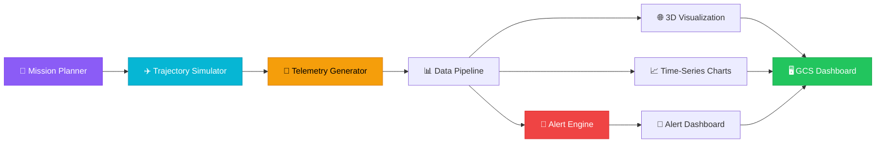
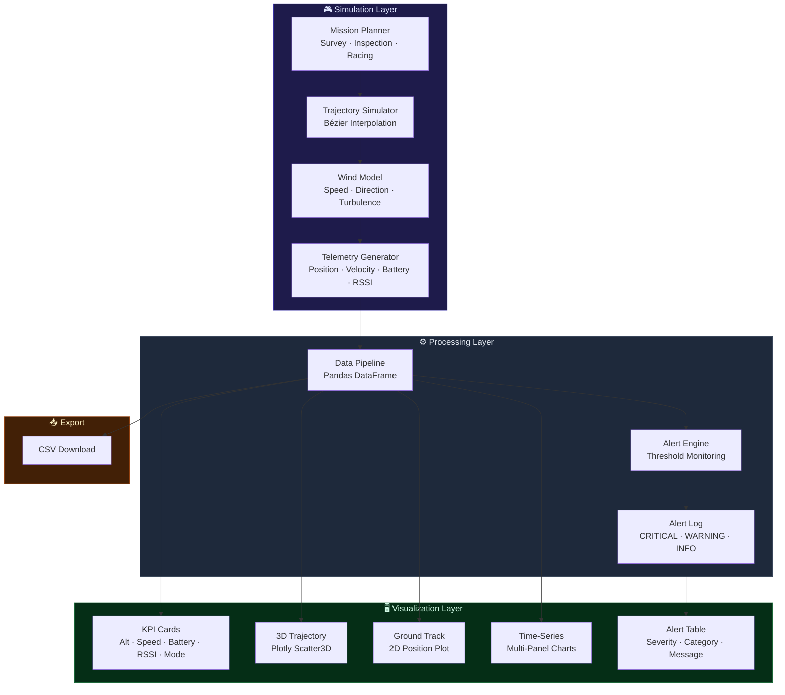

<div align="center">

# 🛸 UAV Telemetry Dashboard

**Real-time Ground Control Station telemetry dashboard**
**with 3D trajectory visualization, mission simulation & alert monitoring**

[](https://python.org)
[](https://streamlit.io)
[](https://plotly.com)
[](LICENSE)
[](https://huggingface.co/spaces/williamsuryap/uav-telemetry-dashboard)

---

*🏆 KRTI 1st Place • 3D Trajectory • Real-time Alerts • Mission Profiles*

</div>

---

## 📋 Overview

A high-fidelity **UAV Ground Control Station (GCS) dashboard** built for the **Kontes Robot Terbang Indonesia (KRTI)** competition, earning **1st Place** honors. The dashboard provides real-time telemetry visualization, 3D trajectory tracking, and intelligent alert monitoring for unmanned aerial vehicles.

### Key Features

| Feature | Details |
|---------|---------|
| 🌐 **3D Trajectory** | Interactive Plotly 3D trajectory with altitude color mapping |
| 🗺️ **Ground Track** | 2D ground track with speed-based coloring |
| 📊 **Live Telemetry** | Multi-panel time-series: altitude, speed, battery, RSSI |
| 🚨 **Alert Engine** | Threshold-based monitoring with severity classification |
| 🎯 **Mission Profiles** | Survey, Inspection, and Racing mission simulations |
| 🌬️ **Wind Model** | Configurable wind speed, direction, and turbulence |
| 📥 **Data Export** | Download telemetry data as CSV |
| 🎨 **Dark Theme** | Professional dark GCS aesthetic with KPI cards |

---

## 🏗️ System Architecture



### Detailed System Flow



---

## 🚀 Quick Start

### Installation

```bash
git clone https://github.com/williamsuryap/uav-telemetry-dashboard.git
cd uav-telemetry-dashboard
pip install -r requirements.txt
```

### Run the Dashboard

```bash
streamlit run app.py
```

Then open **http://localhost:8501** in your browser.

---

## 🎮 Usage Guide

### Sidebar Controls

1. **Mission Profile** — Select from Survey, Inspection, or Racing
2. **Simulation Settings** — Duration, sample rate, wind parameters
3. **Alert Thresholds** — Battery, altitude, RSSI limits
4. Click **🚀 Run Simulation** to generate telemetry

### Dashboard Tabs

| Tab | Description |
|-----|-------------|
| 🌐 **3D Trajectory** | Interactive 3D flight path with altitude coloring |
| 🗺️ **Ground Track** | 2D overhead view with speed coloring |
| 📊 **Telemetry Charts** | Altitude, speed, battery, RSSI over time |
| 🚨 **Alerts** | Alert log table + distribution pie chart |
| 📋 **Raw Data** | Full telemetry DataFrame + CSV download |

### Mission Profiles

| Profile | Pattern | Altitude | Speed |
|---------|---------|----------|-------|
| 🗺️ Survey | Grid/lawnmower | 50m | 8 m/s |
| 🔍 Inspection | Circular orbit | 30m | 5 m/s |
| 🏎️ Racing | Waypoint sprint | 15m | 18 m/s |

---

## 📁 Project Structure

```
uav-telemetry-dashboard/
├── app.py                    # Streamlit dashboard
├── requirements.txt          # Python dependencies
├── README.md                 # This file
├── utils/
│   ├── __init__.py
│   ├── telemetry.py          # Telemetry data generator
│   ├── trajectory.py         # 3D trajectory simulator
│   └── alerts.py             # Alert engine
└── assets/
    └── sample_mission.json   # Pre-built mission waypoints
```

---

## 🚨 Alert System

The dashboard monitors these parameters in real-time:

| Parameter | Warning | Critical | Action |
|-----------|---------|----------|--------|
| 🔋 Battery | ≤30% | ≤15% | RTL recommended |
| 📏 Altitude | >120m | — | Altitude limit |
| 📡 RSSI | ≤-70 dBm | ≤-85 dBm | Signal loss |
| 💨 Speed | >25 m/s | — | Overspeed |
| 🛰️ GPS | <6 sats | — | Poor fix |
| 🗺️ Geofence | — | >500m | Boundary breach |

---

## 🏆 Competition Context

This dashboard was developed as part of the **KRTI (Kontes Robot Terbang Indonesia)** national UAV competition, where our team achieved **1st Place**. The GCS system provided:

- Real-time telemetry monitoring during autonomous missions
- 3D trajectory replay for post-flight analysis
- Alert-driven decision support for mission operators
- Comprehensive data logging for competition judging

---

## ⚙️ Configuration

| Parameter | Default | Description |
|-----------|---------|-------------|
| `sim_duration` | 300s | Simulation length |
| `sim_dt` | 1.0 Hz | Telemetry sample rate |
| `wind_speed` | 3.0 m/s | Wind disturbance |
| `noise_level` | 0.3 | Sensor noise intensity |

---

## 📄 License

This project is licensed under the **MIT License** — see [LICENSE](LICENSE) for details.

---

<div align="center">
<sub>Built with ❤️ by <a href="https://github.com/williamsuryap">William Surya</a> • 🏆 KRTI 1st Place</sub>
</div>
